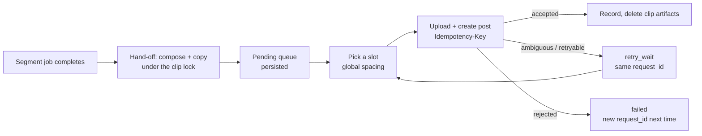

# Live monitor

The live monitor watches creator channels and turns their content into
published shorts without manual steps. It runs inside the backend process
(`monitoring/live_monitor.py`: `LiveMonitorRegistry` plus one strategy per
platform) and submits ordinary jobs through the same queue as the dashboard.

## What it watches

| Platform | `live` mode | `vod` mode |
|----------|-------------|------------|
| Kick | Captures the running stream in segments (default 30 min) and processes each segment as a job | Processes each new VOD |
| Twitch | Same as Kick (Helix app credentials required) | Processes each new VOD |
| YouTube | — | New long-form uploads from the channel's RSS feed (Shorts are excluded by the feed choice), from activation onward |

Several monitors run at once, one per platform + channel. State survives
restarts in `data/live_monitor.json`; monitors marked `resume_on_start` start
again automatically.

## Per-monitor behaviour

- **Prelive skip** (`prelive_skip_seconds`, default 30 min): the waiting screen
  at the start of a stream is skipped, measured from the stream's own start
  time. On Kick and Twitch it also applies to VODs; never to YouTube uploads.
- **Catch-up** (`catchup`, live mode only, chosen at start): `backfill`
  recovers stream time that passed before capture began — on Twitch by range
  download from the in-progress archive VOD (matched by `stream_id`), on Kick
  from the replay once the stream ends, since Kick publishes no VOD while live.
  `live_only` starts coverage at launch.
- **Clip selection**: `fixed` publishes the top `max_clips` (default 5) of a
  segment by viral score; `auto` first drops clips under `min_viral_score`
  (default 70), so a weak segment yields fewer clips or none. `max_clips: 0`
  means no cap. Monitor jobs never fall back to TextTiling or a whole-video
  render.
- **Look**: monitor clips always render with reframe `disabled` (letterbox,
  optional `letterbox_zoom`), a full-clip hook, the attribution banner attached
  under the video band, and subtitles; `smart_cut` is opt-in. All overridable
  per monitor.
- **Chat signal** (`chat_signal`, default on, Kick and Twitch `live` mode):
  while a segment is captured, `integrations/chat_listener.py` reads the
  channel's chat anonymously (read-only; nothing is ever sent). Kick's Pusher
  app key rotates (October 2026), so the listener asks Kick's realtime
  endpoint for the current key and cluster, caches it for an hour, re-asks
  after a refused connection, and falls back to a known key. A silent minute
  triggers a ping; only a second silent minute reconnects. When the
  segment is submitted, `monitoring/chat_signal.py` bins the messages into
  10-second buckets, weighting reaction messages (KEKW, `????`, W) double, and
  marks buckets at 2.5x the segment's median and at least 8 weight as spikes.
  Up to five spike windows, each starting 20 s early to include the build-up,
  are appended to the segment's AI instructions as a hint. Gemini still picks
  the clips; the hint only points it at moments the transcript can miss. A
  quiet chat (under 30 messages), a connection failure or a format change
  yields no hint, and the segment is clipped as before. Backfill segments
  carry no hint, since their chat was not recorded.
- **Chat fallback when Gemini is out of quota:** the spike windows are also
  written to `chat_spikes.json` in the segment's job directory. When every
  Gemini model is rate-limited, the orchestrator builds clips from them
  (`pipeline/analysis/chat_fallback.py`) instead of skipping the segment:
  15-60 s windows around the strongest spikes, generic reaction titles and
  hooks, scores of 72-90 by spike strength, the same `max_clips` and score
  floor as a Gemini result, and `clip_source: chat_fallback` in the metadata.
  They then go through the normal snapping, rendering and publishing.
- **Runtime config**: `POST /api/live-monitor/{id}/config` changes an
  allow-listed set of fields (templates, instructions, spacing, segment
  length, platforms, look, chat signal); changes apply to future clips. Platform, mode and
  channel need a new monitor.

## Publishing flow

- Posts from **all** monitors share one spacing rule (`min_gap_seconds`,
  default 15 min) enforced through the global `picked_slots` list under the
  monitor publish lock.
- **Post timing** (`post_timing`): `prime_time` schedules each clip at a
  random time inside the day's prime-time windows, which can be hours after it
  was ready. `asap` (default) schedules it two minutes out, or as soon as the
  minimum gap allows, never between 01:00 and 08:00 in the monitor's timezone;
  a clip ready after 22:00 still goes out that evening.
- **Daily cap** (`max_posts_per_day`, default 6; 0 = none): once a local day holds
  that many posts (this and every other monitor's picks, plus Zernio's posts
  for the target day), the clip moves to the next day, at most 14 days ahead.
  Zernio's occupancy is only known for the first day tried, so posts made
  outside ClippyMe on later days are not counted.
- `min_gap_seconds`, `post_timing` and `max_posts_per_day` are re-read before
  every publish, so a runtime config update applies to the next clip.
- **Review window** (`review_minutes`, default 15; 0 = none): a newly queued clip
  is stamped `review_until = queued_at + review_minutes`. Until then it is not
  due, so it sits in the dashboard list with its Discard button; afterwards
  the drain publishes it like any other entry. An entry is due at the later of
  `review_until` and its retry `next_retry_at`. Re-queuing an entry (restore)
  keeps its original clock, and changing `review_minutes` affects only clips
  queued afterwards.
- A snapshot written by an older version holds `None` for fields added since.
  `auto_resume()` re-validates every snapshot config, so those fields take
  their defaults; values the owner set are kept.
- Title and caption templates accept `{title}` and `{hook}`; optional AI
  instructions steer clip selection.
- Publishing can be paused and resumed per monitor
  (`POST /api/live-monitor/{id}/publishing`). Pending clips are persisted and
  drain on resume or after a restart.
- While clips wait, the dashboard lists them (`pending_clips` in the monitor
  status) with a preview and a Discard button
  (`POST /api/live-monitor/{id}/pending/{publication_id}/discard`). Discarding
  removes the entry from the persisted queue and deletes the monitor's composed
  copy; the clip stays in its job for History and manual publishing. A clip
  already `in_flight` answers 409. The drain re-checks the queue after its
  spacing sleep, so a clip discarded during that sleep is never published.
- A publication has a stable `publication_id` and a `request_id` used as the
  Zernio `Idempotency-Key`. Retries back off from 60 s to 1 h, at most 8
  attempts. Identity and idempotency rules are in
  [publishing.md](publishing.md#publish-identities).
- After a confirmed publish the clip's files are deleted (default
  `delete_after_publish: true`) and its metadata entry is marked
  `deleted_after_publish`. Positions in `shorts` stay stable, so consumers
  address clips by `original_index`.
- While the monitor owns a clip (job not yet handed off, or publication
  queued / in flight / waiting to retry) a manual publish of that clip answers
  409. A failed publication releases it.

## Phone notifications

With an ntfy topic saved (`NTFY_TOPIC`, Settings), `integrations/notifier.py`
posts to ntfy.sh: one notification per batch of newly queued clips (titles,
scores, and when they post given the review window and auto-publish state),
and one when a clip fails to post for good. A re-queued entry (restart
hand-off) does not notify again. Sending runs in a worker thread, is
best-effort and never raises into the monitor.

Health alerts use the same channel for problems that would otherwise stop
clipping silently, each at most once per hour per kind (`_alert`):

| Alert | When |
|-------|------|
| Can't check channel | Live-state checks failed `PROVIDER_ALERT_AFTER` (5) times in a row |
| Gemini quota used up | A segment came back `gemini_exhausted` and was skipped |
| Segment failed | A segment job ended `failed` (with its last log line) |
| Disk almost full | Under `LOW_DISK_ALERT_GB` (5 GB) free after a capture; at most every 6 h |
| Monitor didn't restart | `auto_resume()` could not start a saved monitor |

## Failure handling

| Situation | Behaviour |
|-----------|-----------|
| Job queue full | Waited out with capped backoff (≤ 120 s), shown in `last_error` |
| Provider or network error checking live state, or resolving a YouTube channel | Retried with backoff up to 15 min |
| Invalid channel (`ValueError`) or a bug | The monitor stops with the error |
| Restart while a segment job had finished but not been handed off | The finished job is rebuilt from its runtime state and final metadata, and handed off once |
| Restart while a backfill job was running | The backfill window already belongs to that job, so it is re-attached, not cut again |

`picked_slots` and the `published` dedup guard are pruned by retention
windows derived next to `PICKED_SLOT_RETENTION_SECONDS` and
`PUBLISHED_RETENTION_SECONDS`; the failed-publication list is bounded.

Delivery is at least once: a crash between the provider accepting a post and
the monitor recording it can publish that clip twice after the idempotency
window. See [publishing.md](publishing.md).
